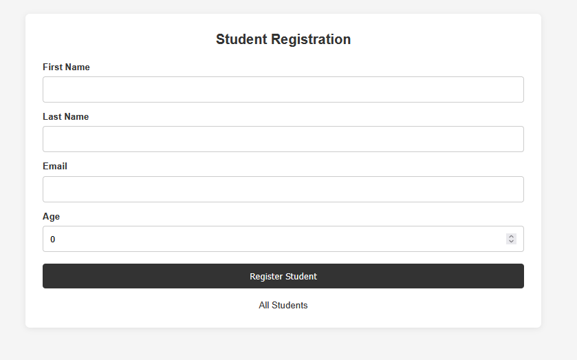
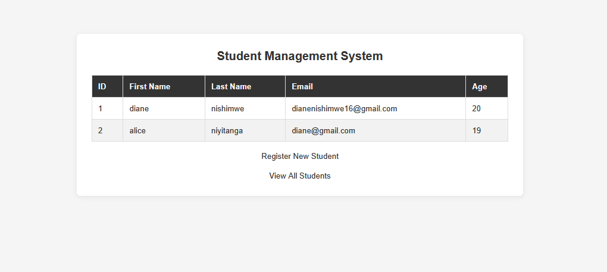
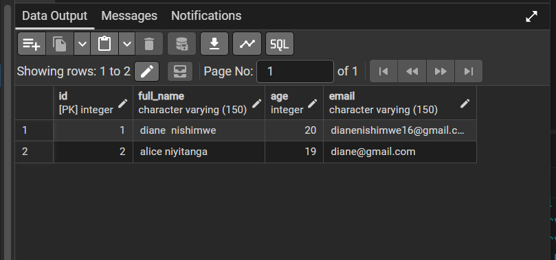

# Student Registration and Management System

## 1. Project Description

The Student Registration and Management System is a web application developed using Spring Boot, Spring MVC, Thymeleaf, Java, JDBC, and PostgreSQL.

The application allows users to register students, save their information in a PostgreSQL database, view all registered students, and search for a specific student using their ID.

## 2. Technologies Used

- Java
- Spring Boot
- Spring MVC
- Thymeleaf
- PostgreSQL
- JDBC
- Maven
- HTML
- CSS
- IntelliJ IDEA

## 3. Project Structure

```text
StudentManagementSystemSpring
│
├── src
│   └── main
│       ├── java
│       │   └── com.example.StudentManagementSystemSpring
│       │       ├── model
│       │       │   └── Student.java
│       │       ├── controller
│       │       │   └── StudentController.java
│       │       ├── service
│       │       │   └── StudentService.java
│       │       ├── repository
│       │       │   └── StudentRepository.java
│       │       ├── config
│       │       └── StudentManagementSystemSpringApplication.java
│       │
│       └── resources
│           ├── templates
│           │   ├── register.html
│           │   └── students.html
│           ├── static
│           │   └── css
│           │       └── style.css
│           └── application.properties
│
├── pom.xml
└── README.md
```

## 4. Database Configuration

The application uses PostgreSQL as its database.

### Create Database

```sql
CREATE DATABASE student_management;
```

Connect to the `student_management` database and create the students table:

```sql
CREATE TABLE students (
    id SERIAL PRIMARY KEY,
    full_name VARCHAR(150),
    age INTEGER CHECK (age > 18),
    email VARCHAR(150) UNIQUE
);
```

### Database Configuration

Configure the database connection in `application.properties`.

```properties
spring.application.name=StudentManagementSystemSpring

server.port=8081

spring.datasource.url=jdbc:postgresql://localhost:5432/student_management
spring.datasource.username=${DB_USERNAME:postgres}
spring.datasource.password=${DB_PASSWORD}
spring.datasource.driver-class-name=org.postgresql

## 5. How to Run the Application

1. Install Java JDK.
2. Install Apache Maven.
3. Install PostgreSQL.
4. Create the `student_management` database.
5. Create the `students` table using the SQL provided above.
6. Configure the database credentials.
7. Open the project in IntelliJ IDEA.
8. Wait for Maven to download the dependencies.
9. Run `StudentManagementSystemSpringApplication.java`.

Open the application in your browser:

```text
http://localhost:8081/student/register
```

## 6. Application Features

- Register a new student.
- Save student information in PostgreSQL.
- Display all registered students.
- Display a specific student using their ID.
- Display a message when a requested student does not exist.
- Navigate between the registration and student list pages.

## 7. Spring Beans and Dependency Injection

### Inversion of Control (IoC)

Inversion of Control is a principle where Spring manages the creation and lifecycle of application objects instead of the programmer creating them manually.

### Spring Beans

Spring Beans are objects managed by the Spring IoC container.

In this project:

- `StudentController` is registered using `@Controller`.
- `StudentService` is registered using `@Service`.
- `StudentRepository` is registered using `@Repository`.

### Dependency Injection

Dependency Injection allows one class to receive the objects it depends on from Spring.

This project uses constructor-based Dependency Injection.

The `StudentController` receives `StudentService` through its constructor, while `StudentService` receives `StudentRepository` through its constructor.

Spring automatically creates and connects these objects.

## 8. Controller Handler Mappings

The application uses one `StudentController` to handle different HTTP requests.

| HTTP Method | Endpoint | Description |
|---|---|---|
| GET | /student/register | Displays the registration form |
| POST | /student/register | Receives and saves student information |
| GET | /student/all | Displays all registered students |
| GET | /student/{id} | Displays a specific student by ID |

The controller uses:

- `@Controller` to register the controller.
- `@RequestMapping` to define the common URL.
- `@GetMapping` to handle GET requests.
- `@PostMapping` to handle POST requests.
- `@ModelAttribute` to receive form information.
- `@PathVariable` to retrieve the student ID from the URL.
- `Model` to pass information to Thymeleaf pages.

## 9. JDBC Database Integration

The project uses JDBC for database operations without Spring Data JPA or Hibernate.

The `StudentRepository` class handles database communication using:

- `Connection` to establish a database connection.
- `PreparedStatement` to execute SQL queries safely using parameters.
- `ResultSet` to retrieve database records.

The application implements:

- INSERT query to register students.
- SELECT query to retrieve all students.
- SELECT query with WHERE condition to retrieve a student by ID.

First name and last name are combined into `full_name` before saving to the database.

## 10. Thymeleaf Templates

The application uses two Thymeleaf HTML pages.

### register.html

Displays the student registration form with:

- First Name
- Last Name
- Email
- Age
- Register button
- Success message

### students.html

Displays student information in an HTML table.

It uses `th:each` to iterate through student records and displays a message when no students are available.

The same page is reused to display a specific student by ID.

## 11. Screenshots

Add screenshots of your application below:

### Student Registration Page

![Student Registration Page


### Student List Page


![Student List Page


### PostgreSQL Student Records

![Database Records]


## 12. Conclusion

The Student Registration and Management System demonstrates the use of Spring Boot, Spring MVC, Thymeleaf, constructor-based Dependency Injection, Spring Beans, and JDBC database operations.

The application provides student registration, student listing, and student search by ID using PostgreSQL.
